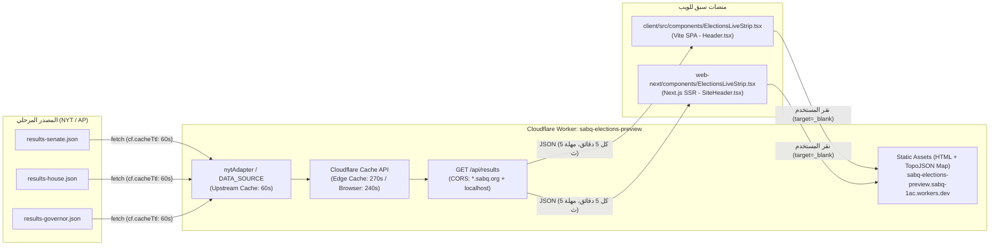

# الدليل التقني: شريط وصفحة نتائج الانتخابات النصفية الأمريكية 2026 المباشرة

يوثّق هذا الدليل بنية التغطية الحية لنتائج الانتخابات النصفية الأمريكية 2026 (`sabq-elections-preview`) وشريط النتائج المباشر (`ElectionsLiveStrip`) المدمج أسفل الترويسة في تطبيق الويب (`client` SPA) وتطبيق العرض الخادمي (`web-next` SSR).

---

## 1. نظرة عامة والمعمارية (Overview & Architecture)

تعمل التغطية عبر طبقتين منفصلتين لضمان عزل الحمل عن خوادم `sabq.org` الأساسية ومنع أي قفزة تخطيط (CLS) أو إبطاء لصفحات الأخبار:

1. **عامل Cloudflare مستقل (`sabq-elections-preview`):** يجلب بيانات النتائج الخام، يطبّعها في هيكل موحّد مصغّر، ويخزّنها على حافة Cloudflare لمدة **270 ثانية** (مع كاش جلبي للمصدر لمدة **60 ثانية**)، ويقدّم كلاً من واجهة الخريطة التفاعلية الكاملة ونقطة النهاية `/api/results` المحمية بـ CORS لنطاقات `sabq.org` فقط.
2. **شريط الهيدر المباشر (`ElectionsLiveStrip`):** مكوّن خفيف بارتفاع ثابت (`h-9` / `36px`) يظهر أسفل الهيدر في جميع الصفحات، يستعلم عن `/api/results` كل **5 دقائق** لعرض توازن مقاعد مجلس الشيوخ، ويوجّه القارئ عند النقر إلى صفحة النتائج الكاملة.



---

## 2. مصادر البيانات والعقد البرمجي (Data Sources & Adapter)

### أ. المسارات المصدرية الدقيقة (Upstream Endpoints)
يقرأ المحوّل الحالي (`nytAdapter` في `src/worker.js`) ثلاثة ملفات JSON عامة تنشرها نيويورك تايمز استناداً إلى أرقام وكالة أسوشيتد برس (AP) لانتخابات **2026-11-03**:

- **مجلس الشيوخ (`senate` → `S`):**
  `https://static01.nyt.com/elections-assets/pages/data/2026-11-03/results-senate.json`
- **مجلس النواب (`house` → `H`):**
  `https://static01.nyt.com/elections-assets/pages/data/2026-11-03/results-house.json`
- **حكّام الولايات (`governor` → `G`):**
  `https://static01.nyt.com/elections-assets/pages/data/2026-11-03/results-governor.json`

يُرسل العامل الطلبات بالتوازي (`Promise.all`) مع ترويسة `User-Agent: sabq-elections-preview/0.1 (internal)` وخيار `{ cf: { cacheTtl: 60 } }`، ويستبعد السباقات ذات المستوى الوطني (`top_reporting_unit.level !== "national"`).

### ب. الحقول المستخدمة والتطبيع (Normalized Schema)

1. **توازن القوى (`normBalance`):**
   يُستخرج من `partyControlData.results[0].offices[k]` (`k` هو `S` أو `H` أو `G`) ويُحوَّل إلى:
   - `total`: إجمالي المقاعد (100 للشيوخ، 435 للنواب).
   - `toWin`: عدد المقاعد اللازمة للأغلبية (`{ DEM, GOP, OTH }`).
   - `called`: عدد السباقات المحسومة (`num_races_called`).
   - `up`: المقاعد المطروحة للانتخاب في هذه الدورة (`open_seats`).
   - `D` و`R` و`I`: كائن لكل حزب من `party_balance.{DEM,GOP,OTH}` يحتوي على:
     - `seats`: المقاعد المحسومة/الحالية (`seats`).
     - `noElection`: المقاعد غير المطروحة للانتخاب هذا العام (`no_election`).
     - `flips`: صافي المقاعد المنتزعة (`flip_count`).
     - `winner`: منطقي يوضح حسم الأغلبية (`!!winner`).

2. **السباقات الفردية (`normRace`):**
   تُستخرج من `races[]` (مع `top_reporting_unit` و`candidate_metadata` و`outcome`) وتُختصر إلى:
   - `id`: معرّف السباق (`nyt_id`، مثل `AL-G-S-2026-11-03`).
   - `o`: المنصب (`senate` | `house` | `governor`).
   - `st`: رمز الولاية من حرفين (`state_postal`، مثل `AL`).
   - `sn`: اسم الولاية بالإنجليزية (`top_reporting_unit.name`).
   - `dist`: رقم الدائرة الانتخابية لمجلس النواب (`District (\d+)`، أو `0` لدوائر `At-Large`، أو `null` للشيوخ/الحكّام).
   - `status`: حالة الحسم (`race_call_status`).
   - `winner`: الحزب الفائز (`D` | `R` | `I` | `null`) بناءً على `outcome.won`.
   - `flip`: هل انتُزع المقعد من حزب آخر (`outcome.gained === true`).
   - `calledBy` و`calledAt`: الجهات المعلنة (`outcome.called_by`) ووقت الحسم (`outcome.winner_accepted_at[0]`).
   - `rating`: تصنيف التنافسية المسبق (`rating`، مثل `solid-rep` أو `toss-up`).
   - `eevp`: النسبة التقديرية للأصوات المفروزة (`top_reporting_unit.eevp`).
   - `votes`: مجموع أصوات المرشحين في السباق، و`upd`: طابع آخر تحديث (`provider_updated_at || updated_at`).
   - `c`: أعلى 6 مرشحين مرتبين بالأصوات ثم الفوز، لكل مرشح: `{ id, n, p, inc, v, w, l, pct }` (حيث `inc` شاغل المنصب، `v` الأصوات، `w` فائز، `l` متقدم، `pct` النسبة المئوية لأقرب عُشر).

### ج. الوضع القانوني والقرار الإداري
- **مصدر مرحلي غير مرخّص للإنتاج العام الدائم:** البيانات الحالية هي أرقام AP المنشورة في ملفات NYT العامة (`source: "nyt-preview"`، وتحمل الوسم النصي `"AP عبر ملفات NYT العامة — معاينة داخلية فقط"`).
- **قرار الاعتماد المرحلي:** اعتُمد هذا المصدر بقرار من **علي بتاريخ 2026-11-04** كمصدر مرحلي مؤقت لتغطية ليلة الانتخابات لحين تفعيل رخصة رسمية.

### د. خطة التحول إلى خلاصة مرخّصة (AP Elections API / Decision Desk HQ)
صُمّم العامل بنمط المحوّلات القابلة للتبديل (`DATA_SOURCE` adapter):
- يفحص العامل المتغير `env.DATA_SOURCE` في دالة `results(env, ctx)`.
- عند التعاقد مع **AP Elections API** (باستخدام `AP_API_KEY`) أو **Decision Desk HQ (DDHQ)**، يُضاف محوّل `apAdapter(env)` أو `ddhqAdapter(env)` في `src/worker.js` ليُنتج نفس عقد الـ JSON أعلاه (`{ source, sourceLabel, demo: false, fetchedAt, offices: { senate, house, governor } }`).
- بعدها يُغيَّر متغير البيئة `DATA_SOURCE` في إعدادات العامل من `nyt-preview` إلى `ap` (أو `ddhq`) دون أي تعديل أو إعادة نشر لكود `sabq.org` أو `web-next`.

---

## 3. مزايا صفحة النتائج التفاعلية (Page Features)

تُقدَّم صفحة النتائج من أصول العامل الثابتة (`env.ASSETS`) على `https://sabq.org/elections` وتبقى متاحة أيضاً على `https://sabq-elections-preview.sabq-1ac.workers.dev`.

**مسارات Cloudflare الحيّة (zone sabq.org، أضيفت 2026-11-04) → العامل `sabq-elections-preview`:**

| النمط | Route ID |
|---|---|
| `sabq.org/elections` | `950f6756f4724744925db2f6319ecfe9` |
| `sabq.org/elections/*` | `871fcdb4542441e4a32e8d3de6102943` |

يزيل العامل البادئة `/elections` قبل التوجيه، ويعيد كتابة روابط HTML المطلقة عبر `HTMLRewriter`، وتستخدم السكربتات `window.__BASE` للأصول ونقطة `/api/results` وروابط المشاركة (`?office=&state=&race=`). لا يمسّ العامل `/robots.txt` الخاص بـ sabq.org (يُخدم robots الخاص بالعامل على workers.dev فقط). تشمل الصفحة:

1. **الأقسام الثلاثة:**
   - **مجلس الشيوخ (Senate):** شريط توازن الأغلبية (51 مقعداً للديمقراطيين، 50 للجمهوريين) مع تفصيل المقاعد المحسومة والحالية والمقاعد غير المطروحة (`noElection`).
   - **مجلس النواب (House):** شريط توازن الـ 435 مقعداً (218 للأغلبية) وتصفية الدوائر حسب الولاية وحالة الحسم والمقاعد المتأرجحة (`flip` / `toss-up`).
   - **حكّام الولايات (Governors):** قائمة وسباقات الولايات الـ 36 المطروحة في انتخابات 2026.

2. **خريطة الدوائر والولايات (Census TopoJSON):**
   - تعتمد خريطة دوائر مجلس النواب على ملف التعداد الأمريكي **`cb_2024_us_cd119_20m` TopoJSON** (المقدم ضمن `/vendor/`).
   - **تنبيه جغرافي مهم (Redistricting Caveat):** تعكس طبقة `cb_2024_us_cd119_20m` حدود دوائر **الكونغرس الـ 119**؛ وقد أعادت بعض الولايات ترسيم حدود دوائرها الانتخابية لدورة 2026 (الكونغرس الـ 120)، لذا قد تختلف الحدود الجغرافية المرسومة في تلك الولايات عن الحدود القانونية الجديدة لعام 2026 بينما تبقى أرقام الدوائر (`dist`) ونتائجها النصية دقيقة من المصدر.

3. **بطاقات المشاركة (Share Cards):**
   - توليد بطاقات بصرية جاهزة للمشاركة لأي سباق أو لتوازن المجلسين بالهوية العربية لـ «سبق».

4. **الروابط العميقة (Deep Links):**
   - تدعم الصفحة معاملات الاستعلام للربط المباشر بالحالة:
     `?office=<senate|house|governor>&state=<postal>&race=<race_id>`
     (مثال: `?office=senate&state=GA` أو `?office=house&state=PA&race=PA-G-H-7-2026-11-03`).

5. **التحديث التلقائي ووضع البيانات التجريبية (Sample-Data Fallback):**
   - تحدّث الصفحة بياناتها تلقائياً كل **5 دقائق**.
   - إذا فشل جلب المصدر في العامل أو كان `DATA_SOURCE` غير مهيأ، يعيد `/api/results` الكائن الاحتياطي `{ source: "sample", sourceLabel: "بيانات تجريبية", demo: true, error: "...", offices: {} }` بحالة HTTP 200، وتعرض الصفحة بيانات المعاينة التجريبية مع تنبيه واضح بأنها بيانات تجريبية.

6. **معاينة الرابط عند المشاركة (واتساب، X، تيليجرام):**
   - يحمل `dist/index.html` وسوم `description` و`og:*` و`twitter:*` بروابط مطلقة إلى `https://sabq.org/elections`، وصورة ثابتة `dist/og.jpg` (1200×630، JPEG نحو 54 KB، أقل من حد واتساب 300 KB).
   - الروابط في وسوم `meta` مطلقة عمداً لأن `HTMLRewriter` في العامل يعيد كتابة `src` و`href` فقط.
   - عند تغيير الصورة أو النص: عدّل الملفين ثم انشر العامل. واتساب يحفظ المعاينة لكل رابط، فالرابط الذي شورك قبل الإصلاح قد يحتاج معامل استعلام جديداً (مثل `?v=2`) ليظهر بالمعاينة الجديدة.

---

## 4. شريط الهيدر في موقع سبق (`ElectionsLiveStrip`)

### أ. المكوّنات ومواضع الإدراج
- **تطبيق الويب (SPA):**
  - المكوّن: `client/src/components/ElectionsLiveStrip.tsx`
  - موضع الإدراج: في `client/src/components/Header.tsx` مباشرةً بعد `</Sheet>` وقبل `<AudioBulletinBar />` و`<BreakingNewsTicker />`.
- **تطبيق العرض الخادمي (SSR):**
  - المكوّن: `web-next/components/ElectionsLiveStrip.tsx` (`"use client"`)
  - موضع الإدراج: في نهاية `<header>` داخل `web-next/components/SiteHeader.tsx`.
- **ثبات التخطيط (Zero CLS):** بارتفاع ثابت `h-9` (`36px`). يظهر توازن مجلس الشيوخ (`الشيوخ د X – ج Y`) كشارة داخلية مخفية على الجوال (`hidden sm:inline-flex`) دون تغيير ارتفاع الشريط عند وصول البيانات.

### ب. متغيرات البيئة وإيقاف الشريط

| المتغير في `client` (Vite) | المتغير في `web-next` | القيمة الافتراضية | الوصف |
|---|---|---|---|
| `VITE_ELECTIONS_STRIP_ENABLED` | `NEXT_PUBLIC_ELECTIONS_STRIP_ENABLED` | مفعّل (`!== "false"`) | ضبطه على `"false"` يعطّل الشريط ويمنع أي طلب شبكي |
| `VITE_ELECTIONS_URL` | `NEXT_PUBLIC_ELECTIONS_URL` | `https://sabq.org/elections` | رابط الوجهة عند النقر على الشريط |
| `VITE_ELECTIONS_API_URL` | `NEXT_PUBLIC_ELECTIONS_API_URL` | `<ELECTIONS_URL>/api/results` | نقطة نهاية JSON لجلب توازن مجلس الشيوخ |

**كيفية إيقاف الشريط فوراً:**
- اضبط `VITE_ELECTIONS_STRIP_ENABLED=false` في بيئة بناء Cloudflare Pages، و`NEXT_PUBLIC_ELECTIONS_STRIP_ENABLED=false` في خدمة `web-next` على Railway/Render، ثم أعد النشر.

### ج. الإخفاء المحلي (`localStorage` Dismiss)
- عند ضغط القارئ على زر الإغلاق (`×`)، يُحفظ `"1"` في `window.localStorage` تحت المفتاح:
  `sabq-elections-strip-2026-dismissed`
- في `client` (SPA)، يُقرأ المفتاح بشكل متزامن عند تهيئة الوحدة (`INITIAL_DISMISSED = readDismissed()`) حتى لا يظهر وميض (Flash) للمستخدم الذي أخفى الشريط مسبقاً.
- في `web-next` (SSR)، يُرسم الشريط مبدئياً على الخادم لتجنب عدم تطابق الـ Hydration، ثم يُفحص `readDismissed()` داخل `useEffect` فور التحميل لإخفائه إن كان القارئ قد أغلقه.

### د. الفشل الصامت (Silent Failure)
- يستخدم الجلب `AbortController` بمهلة صارمة قدرها **5000 مللي ثانية (5 ثوانٍ)** مع `credentials: "omit"`, ويتكرر كل **5 دقائق** (`REFRESH_MS = 300000`).
- لا يُعرض عدّاد المقاعد إلا إذا تحقق الشرط:
  `!data?.demo && b && Number.isFinite(b.D?.seats) && Number.isFinite(b.R?.seats)`
- إذا سقط العامل، أو انتهت المهلة، أو عادت بيانات تجريبية (`demo: true`)، يُبتلع الخطأ بصمت ويبقى الشريط ظاهراً كرابط مباشر نظيف بدون أرقام غير موثوقة.

### هـ. توافق سياسة أمن المحتوى (CSP) و CORS
- يسمح إعداد CSP الحالي في المنصة (`connect-src https:`) بطلبات `fetch` المباشرة من المتصفح إلى `https://sabq.org/elections/api/results` (نفس الأصل).
- يتحقق العامل من ترويسة `Origin` عبر التعبير النمطي:
  `/^https:\/\/([a-z0-9-]+\.)*sabq\.org$/` أو `/^http:\/\/localhost(:\d+)?$/`
  ويُرجع `Access-Control-Allow-Origin: <origin>` مع `Vary: Origin`.

---

## 5. التشغيل والعمليات (Operations)

### أ. كود العامل والنشر عبر Wrangler
- **في هذا المستودع:** تم حفظ الكود المصدري الكامل للعامل وأصوله الثابتة تحت المسار:
  [`tools/elections-worker/`](../tools/elections-worker/)
  - `tools/elections-worker/src/worker.js`: كود العامل ونقطة النهاية `/api/results` ومحوّل `nytAdapter`.
  - `tools/elections-worker/dist/`: الأصول الثابتة (`index.html`، `app.js`، `share.js`، `app.css`، الشعارات، الخطوط، وملفات الخرائط `vendor/cd119.json` و`vendor/states.json`).
  - `tools/elections-worker/wrangler.jsonc`: إعدادات العامل (`name: "sabq-elections-preview"`، ومعرّف الحساب `account_id`، وربط `ASSETS` على `dist`، ومتغير `DATA_SOURCE: "nyt-preview"`).
  *(النسخة الأصلية على جهاز العمليات موجودة أيضاً في `/workspace/sabq-elections`).*
- **طريقة النشر (Deploy):**
  يُنشر العامل مباشرةً من مجلد `tools/elections-worker/` باستخدام `CLOUDFLARE_API_TOKEN` الخاص بحساب Cloudflare:
  ```bash
  cd tools/elections-worker
  CLOUDFLARE_API_TOKEN=<token> npx wrangler deploy
  ```

### ب. منع الفهرسة (`noindex` / `robots.txt`)
لأن الصفحة تستخدم مصدر معاينة مرحلي وتستضاف على نطاق `workers.dev`:
- يُرجع المسار `/robots.txt` في العامل:
  ```text
  User-agent: *
  Disallow: /
  ```
- يمرّر العامل **جميع** الاستجابات (HTML، `/api/results`، والتحويلات؛ و`/robots.txt` على workers.dev فقط) عبر دالة `withRobots` التي تضيف الترويسة:
  `X-Robots-Tag: noindex, nofollow`

### ج. المراقبة والفحص الصحي (Monitoring)
يمكن التحقق من صحة العامل وحالة الكاش ومصدر البيانات عبر الأمر:
```bash
curl -sI -H "Origin: https://sabq.org" https://sabq.org/elections/api/results
curl -s https://sabq.org/elections/api/results | jq '{source, demo, fetchedAt, senate: .offices.senate.balance}'
```
- `x-cache: HIT` أو `MISS` يوضح حالة كاش الحافة الداخلي (`https://cache.internal/sabq-elections/results-v1` ومدته 270 ثانية).
- إذا تحول `demo` إلى `true` أو ظهر الحقل `error` في استجابة JSON، فهذا يعني فشل جلب ملفات NYT أو تغيّر مسارها/هيكلها.

### د. خطة الطوارئ إذا غيّرت NYT تنسيق الملفات أو حجبتها
1. **السلوك التلقائي الفوري:** يلتقط العامل الاستثناء ويعيد `demo: true` (`source: "sample"`). عندها يخفي `ElectionsLiveStrip` شارة مقاعد الشيوخ تلقائياً دون كسر واجهة `sabq.org`.
2. **التشخيص:** افحص حقل `error` في `/api/results` لمعرفة ما إذا كان الخطأ HTTP 403/404 من `static01.nyt.com` أو تغيّراً في مسار JSON (`partyControlData` / `races`).
3. **المعالجة:**
   - إن كان تغييراً بسيطاً في أسماء الحقول داخل ملفات NYT: حدّث دالتي `normBalance` و`normRace` في `tools/elections-worker/src/worker.js` وانشر بـ `CLOUDFLARE_API_TOKEN=<token> npx wrangler deploy` من داخل `tools/elections-worker/`.
   - إن توقف المصدر كلياً قبل جاهزية البديل المرخّص: عطّل الشريط مؤقتاً بضبط `VITE_ELECTIONS_STRIP_ENABLED=false` و`NEXT_PUBLIC_ELECTIONS_STRIP_ENABLED=false`.

---

## 6. الإزالة والتنظيف بعد انتهاء الانتخابات (Post-Election Cleanup)

بعد انتهاء تغطية الانتخابات النصفية الأمريكية 2026 واستقرار النتائج النهائية:

1. **الإيقاف السريع (عبر البيئة):**
   - اضبط `VITE_ELECTIONS_STRIP_ENABLED=false` و`NEXT_PUBLIC_ELECTIONS_STRIP_ENABLED=false`.
2. **تنظيف الكود (في PR مستقل بعد انتهاء التغطية):**
   - إزالة استيراد واستخدام `<ElectionsLiveStrip />` من `client/src/components/Header.tsx` و`web-next/components/SiteHeader.tsx`.
   - حذف الملفين `client/src/components/ElectionsLiveStrip.tsx` و`web-next/components/ElectionsLiveStrip.tsx`.
   - إزالة متغيرات `VITE_ELECTIONS_*` من `.env.example` و`NEXT_PUBLIC_ELECTIONS_*` من `web-next/.env.example`.
3. **إيقاف أو أرشفة العامل:**
   - إما إبقاء العامل `sabq-elections-preview` كأرشيف للقراءة فقط أو حذفه من Cloudflare Workers (الكود محفوظ في `tools/elections-worker/`).
