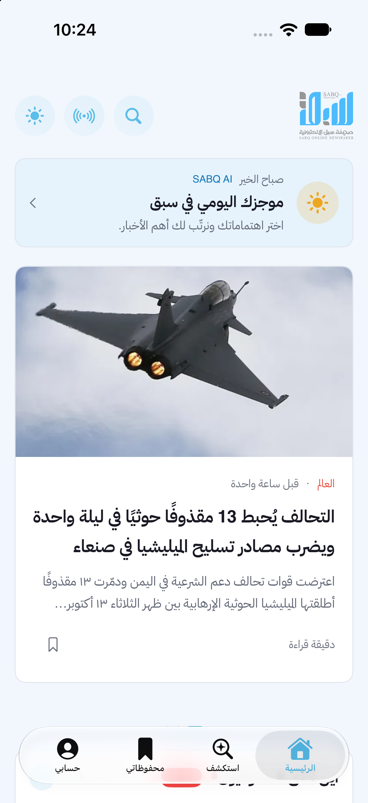
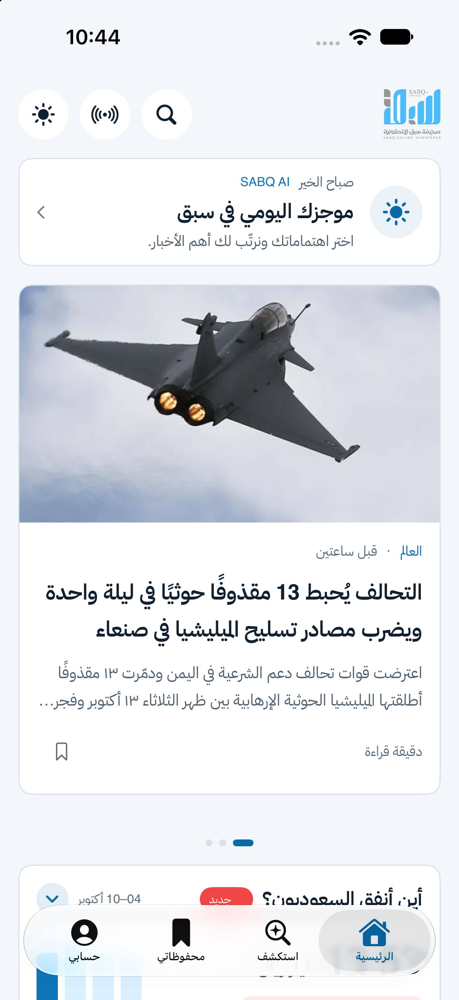
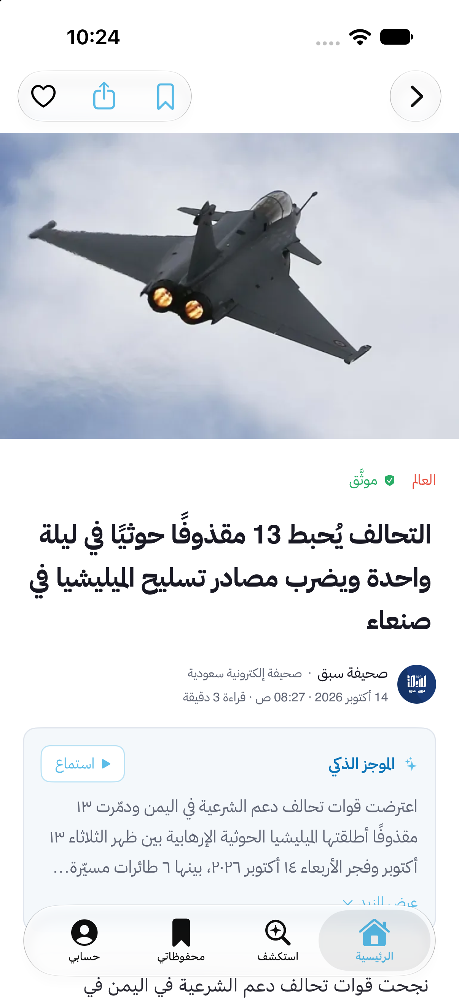
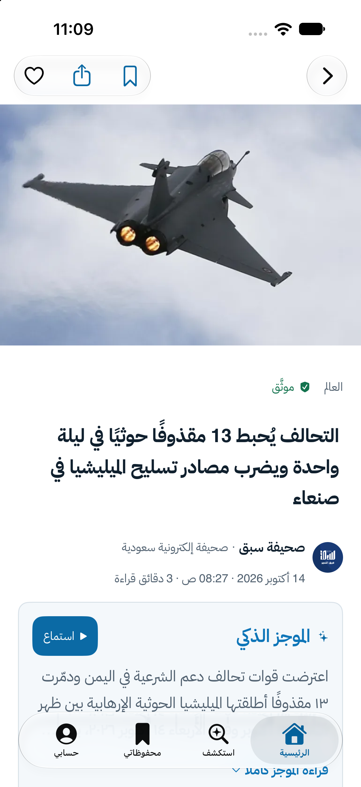
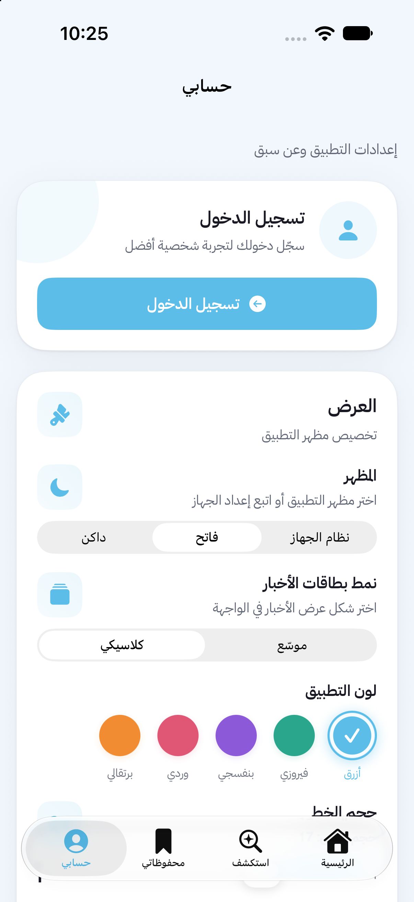
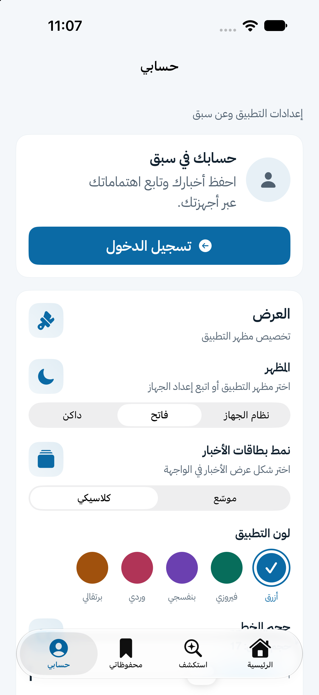

# لغة سبق البصرية — iOS

يوحد هذا التغيير ألوان القراءة والنصوص والخطوط والمسافات والمكونات في الرئيسية والتصنيفات والخبر والبحث والمحفوظات والحساب والدخول والإشعارات، مع ألوان دلالية للفشل والنجاح والتعطيل. يعتمد على SabqTheme وSabqFonts الموجودين، ويضيف SabqLayout وSabqType وSabqInputSurface. تبقى الثيمات الموسمية وأسماء المنتجات ومحتوى الأخبار وعقود API والصلاحيات محفوظة.

## مقارنة فعلية

| الشاشة | قبل | بعد |
|---|---|---|
| الرئيسية |  |  |
| الخبر |  |  |
| حسابي |  |  |

صور قبل من 0f7d0fd. الأخبار حية وقد تختلف التوقيتات. صور الحساب هنا لحالة الضيف فقط.

## التحقق

- 161 اختبارًا ناجحًا لكل من iPhone SE 3 وiPhone 18 Pro Max على iOS 27.0، ثم 161 اختبارًا على الكبير بعد إصلاح تفضيلات الإشعارات، ثم اختبار البحث على الجهازين بعد آخر تعديل له. نتائج xcresult مختصرة مرفقة.
- فحص بصري للفواتح والداكنة وDynamic Type وتسميات AX؛ فحص الحساب والإشعارات أثناء جلسة دخول فعلية دون تبديل إعدادات الحساب.
- اختبارات تباين الألوان الخمسة والحالات المعطلة وزيادة التباين وأولوية الثيم الموسمي؛ مراجعة مستقلة مرفقة.
- حد التشغيل iOS 17.0 محفوظ. لم يتوفر runtime iOS 17، ولم ينفذ اختبار VoiceOver صوتي كامل أو APNs أو نجاح OTP/Apple/Google OAuth.
- جلسة بناء المحاكي غير الموقّع لم تستمر بعد إعادة تشغيله. لا تعديل في AuthStore/APIClient/Keychain؛ تفسير غياب التوقيع محتمل وليس مثبتًا. استمرار الجلسة يحتاج تحقق النسخة الموقعة.
- لا تغييرات Android أو الويب أو الخادم؛ هذه دفعة iOS، وتبقى مطابقة Android لاحقة خارج نطاقها.

[تفاصيل النصوص ونظام التصميم](COPY-CHANGES.md) · [المراجعة المستقلة](final-independent-review.md)
