# تطبيق سبق iOS على iPhone Duo — تنفيذ «الخبر وسياقه» و«مركز المباراة» وإصلاح الشاشة المطوية (15 أكتوبر 2026)

**النطاق:** `sabq app ios` فقط، على الفرع `claude/project-thread-rzqck4` فوق `b7196f5` (main).
**المرجع المعتمد:** نموذج «سبق Duo: الخبر وسياقه، ومركز المباراة» (Artifact، اعتمده المالك في 15 أكتوبر)، ويبني على `ios-duo-review-2026-09-19.md`.
**البيئة:** Xcode 27.1 (27A9269)، ومحاكي iPhone Duo بنظام iOS 27.1 عبر Device Hub، ومحاكي iPhone 17 Pro بنظام iOS 27.0 للتحقق من الأجهزة الأخرى.
**الوسوم:** **[مقيس]** رقم من المحاكي، **[لقطة]** تحقق بصري، **[اختبار]** اختبار وحدة، **[استنتاج]** من الكود دون قياس.

---

## 1. الخلاصة

| البند | النتيجة |
|---|---|
| ضغط الشاشة المطوية | أُصلح من الجذر، وعرض المحتوى زاد من **266 إلى 350 نقطة** (+32%) [مقيس] |
| «الخبر وسياقه» | منفّذ: عمود «الأخبار / سياق الخبر» مفتوحًا، وزر «سياق الخبر» مع ورقة سفلية مطويًا [لقطة] |
| «مركز المباراة» | منفّذ لروشن وكأس الملك: عمودان مفتوحًا، ووضع الطاولة نصف مطوي [لقطة] |
| السرعة والتصفح | ذاكرة جلسة لتفاصيل الخبر، وإصلاح عمود كان يظهر فارغًا، وصف أزرار واحد بدل أزرار مرصوصة عموديًا فوق الصورة |
| الآيفون العادي وiPad | لم يتغيرا: `TabView` النظامي ومسارات العرض نفسها [لقطة iPhone 17 Pro] |

---

## 2. الشاشة المطوية: السبب والإصلاح

### السبب [مقيس]
الشاشة الخارجية بوضعية «الكتاب المغلق» (حساس الكاميرا على الجانب) نافذتها 466×678 نقطة. القياسات من `GeometryReader` واختبار XCUITest:

| المستوى | الحواف (بادئ / ختامي) | العرض المتاح |
|---|---|---|
| النافذة فوق `TabView` | 84 / **0** | 382 |
| داخل `TabView` | 84 / **84** | 298 |
| داخل مكدّسات UIKit (`NavigationStack`)، حتى بعد إزالة `TabView` | 84 / **84** | 298 |
| بطاقات الرئيسية (بعد هامش 16) | — | **266** |

للسبب شقّان:
1. **`TabView` يدخل تخطيطه الأفقي:** يعرض شريطًا رأسيًا ويحجز له 84 نقطة. يبقى الحجز حتى لو أُخفي الشريط بـ `toolbar(.hidden, for: .tabBar)`، ولم يغيّر النتيجة أيٌّ من `defaultTabBarPlacement(.tabBar)` أو `tabViewStyle(.tabBarOnly)` أو `tabBarMinimizeBehavior` أو فرض `verticalSizeClass`.
2. **حاويات UIKit تحسب الحواف بالطريقة القديمة:** `NavigationSplitView` و`NavigationStack` تعطي محتواها حواف متماثلة كهاتف أفقي، مع أن الحساس في جهة واحدة، وتتجاهل أي `safeAreaInset` تضيفه SwiftUI فوقها.

النتيجة: أرقام تنكسر على سطرين («13.53»)، وعناوين مقطوعة («دوري رو…»)، وعمود ضيق.

### الإصلاح (على Duo فقط)
- **`Components/DuoTabContainer.swift`:** على Duo تحل حاوية تبويبات خاصة محل `TabView`.
  - التبويبات الأربعة تبقى حية في `ZStack` فلا تضيع الحالة، ويُبنى كل تبويب عند أول اختيار.
  - الشريط سفلي حين تضيق النافذة عن 600 نقطة. مفتوحًا يكون جانبيًا داخل الشريط الذي يحجزه UIKit أصلًا، فلا يغطي نصًا.
  - لمس التبويب المختار يعيده إلى جذره، كما في النظام.
- **`duoContentInsets()`:** يُطبَّق على جذر كل مكدّس وكل وجهة مسجلة (40 في `SabqDestinations`، وستّ في الشاشات).
  - يلغي الحجز الأفقي المتماثل، ويضع حواف الجهاز الحقيقية، ويضيف ارتفاع الشريط السفلي.
  - خارج الشاشة الضيقة قيمته صفر وبنية العرض ثابتة، فلا يضيع التمرير عند الطيّ والفتح.
- **شريط أدوات القارئ على Duo:** صار عنصرًا أفقيًا واحدًا. الحاوية الثابتة كانت تجعل النظام يرصّ الأزرار عموديًا فوق صورة الخبر، وهذا السلوك سابق لهذا العمل.

| قبل / بعد | |
|---|---|
| الرئيسية مطوية (فاتح) | 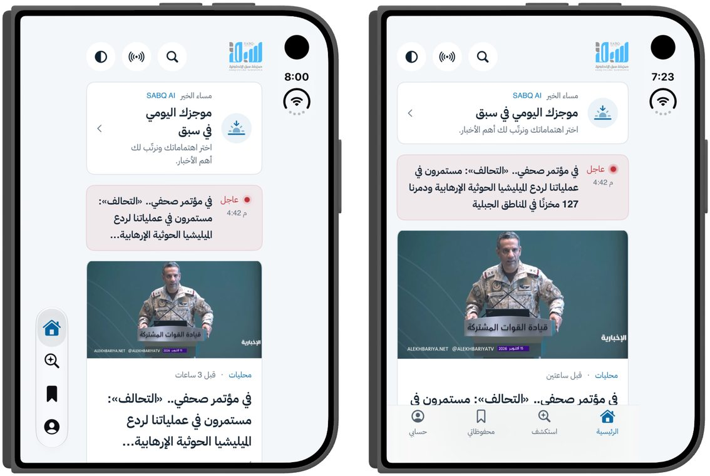 |
| الرئيسية مطوية (داكن) | 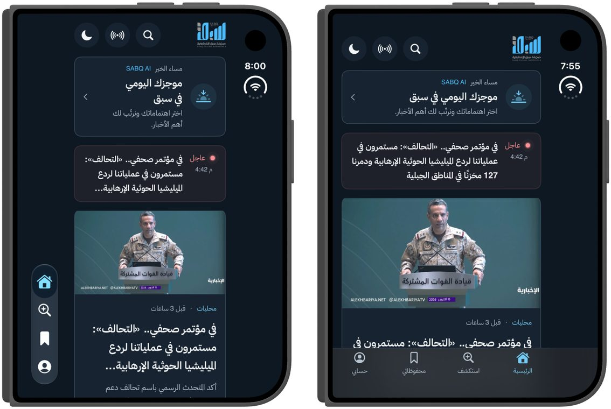 |
| الخبر مطويًا | 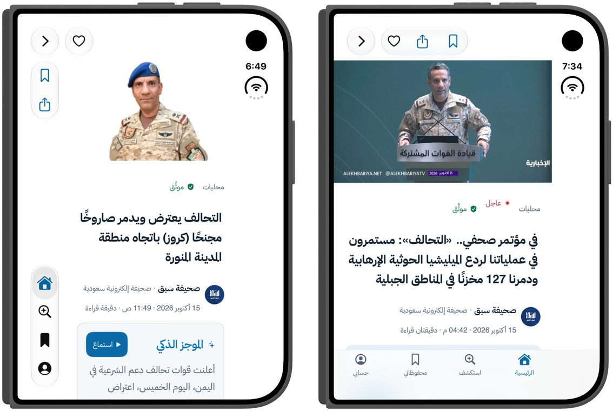 |

---

## 3. «الخبر وسياقه»

### المحتوى
في `Services/ArticleContext.swift`، كدوال صافية مختبرة:
- **الموجز الذكي:** حتى ثلاث نقاط مقسّمة من `aiSummary` (أو من المقتطف)، دون كسر الأعداد العشرية.
- **القصة حتى الآن:** الأخبار المرتبطة الأقدم من الخبر **ومن القصة نفسها**، من الأقدم إلى الأحدث، والخبر الحالي آخرها. تُعرض فقط إن وُجد خبران سابقان على الأقل.
- **أخبار مرتبطة:** الباقي، الأحدث أولًا.
- **كلمات مفتاحية.**
- **للرأي:** «للكاتب نفسه» بدل الخط الزمني.

### لا طلبات جديدة
القارئ ينشر ما حمّله أصلًا في `SabqNavigationState.readerContext`. النشر على Duo فقط، ومن الخبر الظاهر فقط (لا من خبر تغطيه صفحة مدفوعة فوقه).

### مفتوحًا
- أعلى عمود «الرئيسية» مفتاح «الأخبار / سياق الخبر». اختيار خبر ينقل العمود إلى سياقه، والعودة بلمسة.
- الموجز يختفي من القارئ لأنه انتقل إلى العمود، كما في النموذج.
- لمس خبر مرتبط يفتحه في القارئ، ولمس كلمة مفتاحية يفتح صفحتها.

### مطويًا
زر «سياق الخبر» تحت سطر الكاتب يفتح ورقة سفلية بالمحتوى نفسه، وتُغلق الورقة تلقائيًا عند فتح الجهاز.

| | |
|---|---|
| مفتوحًا: القارئ والسياق (قبل / بعد) |  |
| مفتوحًا (داكن) | 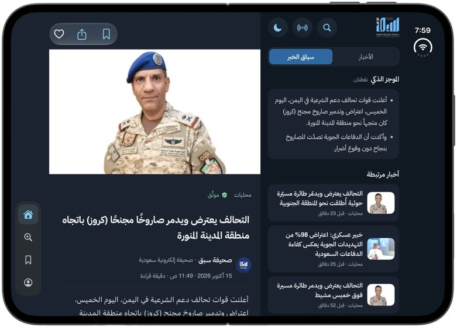 |
| ورقة السياق مطويًا (فاتح / داكن) | 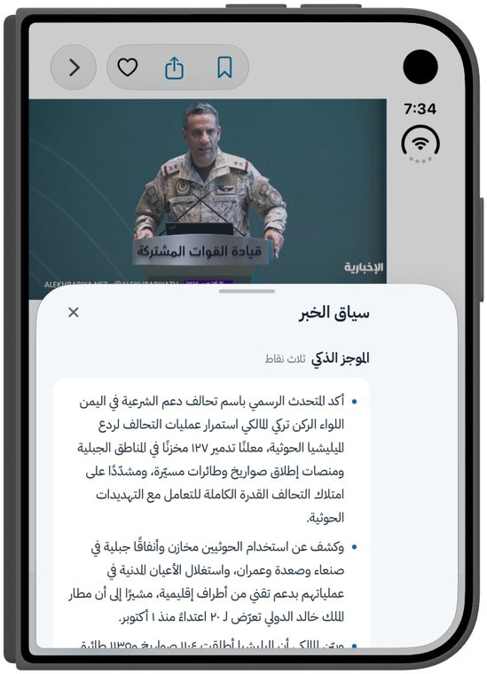 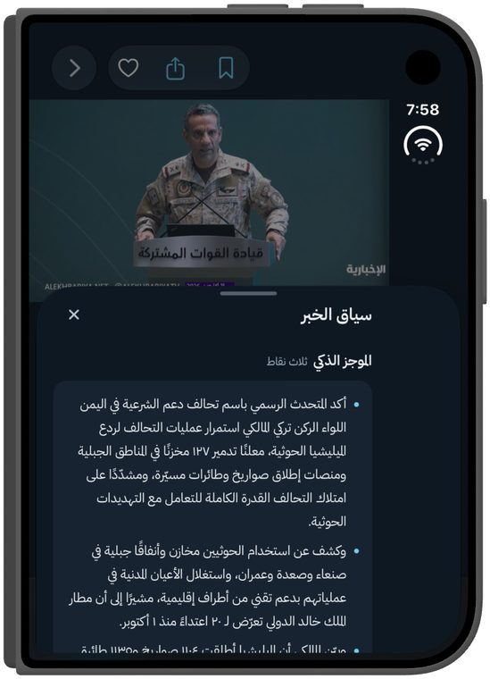 |
| العمود بعد إصلاح التمرير | 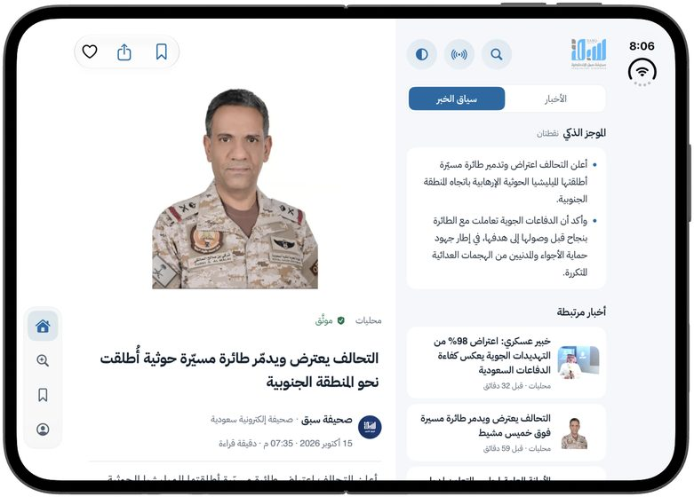 |

### وُجد أثناء التحقق وأُصلح
1. **خط زمني مضلل** [لقطة + اختبار]: «المرتبطة» القادمة من الخادم أخبار حديثة من القسم نفسه، لا من القصة نفسها. خبر مجلس الأمن عن غزة ظهرت تحته أخبار كوسوفو وطوكيو ودرعا كأنها «قصة» (اللقطة 13). الآن لا يدخل الخط إلا ما يشارك العنوانَ كلمتين دالتين بعد تطبيع العربية، أو ما يحمل إحدى الكلمات المفتاحية. الاختبار يستخدم العناوين الحقيقية نفسها.
2. **عمود فارغ** [لقطة]: اختيار خبر من أسفل القائمة كان ينقل العمود إلى السياق الأقصر ويُبقي موضع التمرير بعد نهايته، فيظهر فارغًا. الآن يعود العمود إلى أعلاه.

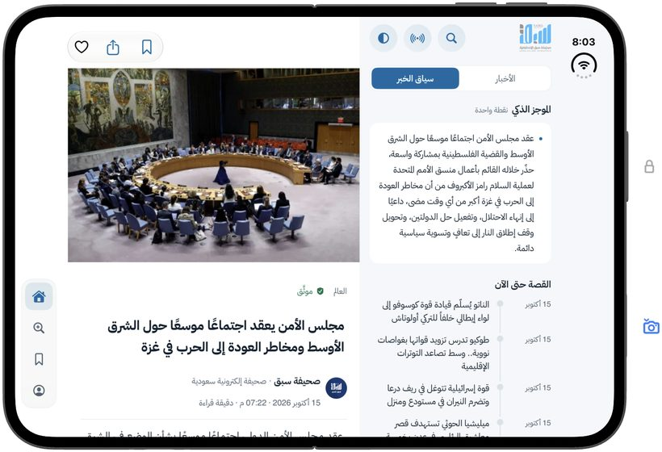

---

## 4. «مركز المباراة»

`Components/DuoMatchLayout.swift` يعيد ترتيب قطع المركز الحالية بحسب الوضعية، ويبقى التبويب المختار والبيانات عند المركز.

- **مفتوحًا أو كتابًا (عرض ≥ 600):** النتيجة و«سير المباراة» يمينًا، والإحصاءات والتشكيلات والتقييمات يسارًا، والفاصل على المفصلة.
- **وضع الطاولة** [مقيس]:
  - يُكشف بشرطين معًا: `onHingeChange` بحالة «نصف مفتوح» (127° على المحاكي)، ومنطقة `reservedRegions(kind: .division)` أفقية (`0, 373.5, 669, 40` على المحاكي).
  - النتيجة مكبّرة ×1.3 فوق المفصلة، ولا شيء على شريطها، والتبويبات تحتها.
  - الشاشة لا تُطفأ أثناء مباراة حية.
- **مطويًا، وعلى الهاتف وiPad:** كما كان.
- **التغطية:** طُبّق على روشن وكأس الملك. لم يُطبَّق على كأس آسيا وكأس العالم، لأن قوائم تبويباتهما ديناميكية وشريطهما يعيد التبويب عند غيابه، فيلزم تكييف أولًا.
- **عرف النتيجة لم يتغير:** الضيف أولًا داخل LTR، والمضيف يمينًا.
- **غير موجود في مركز روشن الحالي:** «توقعك» داخل المركز، والمقطع. لم يُضافا لأن `/api/sports/match/:id` لا يحمل بياناتهما، فتكبر النتيجة وحدها كما ينص النموذج.

| | |
|---|---|
| مفتوحًا (قبل / بعد) | 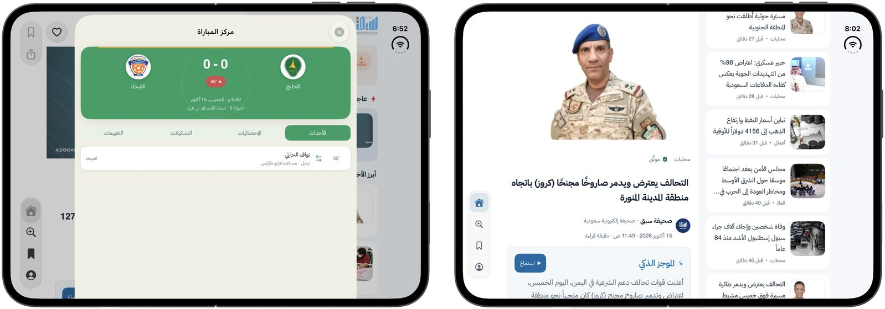 |
| وضع الطاولة (قبل / بعد) | 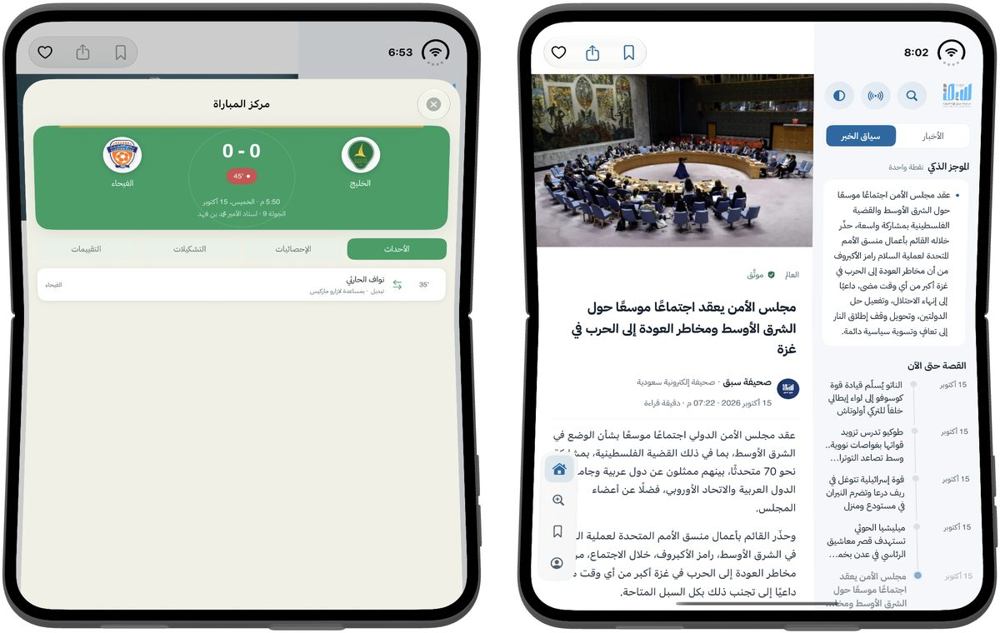 |
| وضع الطاولة (داكن) | 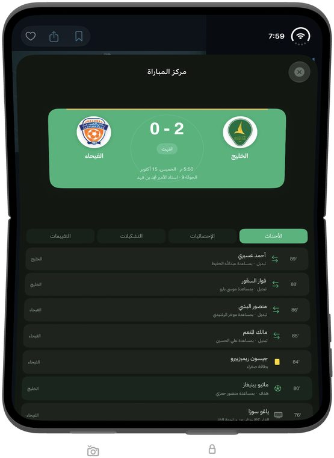 |

---

## 5. السرعة

- **ذاكرة جلسة لتفاصيل الخبر** (`ArticleDetailCache` في `NewsService`، تتسع لـ40 خبرًا):
  - القارئ يعرض النسخة المحفوظة فورًا، ولا يعيد الجلب إن كان عمرها أقل من دقيقتين.
  - تفيد عند طيّ Duo (الجسر يعيد بناء القارئ)، والرجوع من خبر مرتبط، وإعادة فتح خبر من العمود.
  - الطرد والحداثة: [اختبار]. الأثر الزمني على الجهاز: [استنتاج]، لم يُقَس بمؤقت.
- **لم يُضف أي طلب شبكة جديد:** السياق مبني مما يحمّله القارئ أصلًا.

---

## 6. التحقق

- **البناء:** `xcodebuild build` ناجح لـ iPhone Duo (iOS 27.1) ولـ iPhone 17 Pro (iOS 27.0). صفر تحذيرات جديدة في الملفات المعدّلة؛ التحذير الوحيد (`ContentView.swift:251`) موجود من قبل.
- **اختبارات الوحدة:** `sabqTests` كاملة **167/167** ناجحة على iPhone Duo بعد آخر تعديل. الجديد `DuoLayoutTests` (12 اختبارًا):
  - اختيار الوضعية ومناطق الفصل
  - شريط التبويب
  - تقسيم الموجز
  - ترتيب «القصة حتى الآن» وتصفية الضجيج
  - سياق الرأي
  - ذاكرة الجلسة
  - حالة العمود
- **الأجهزة الأخرى:** iPhone 17 Pro يعرض `TabView` النظامي كما كان.

---

## 7. لم يُنفَّذ / لم يُتحقق

- **كأس آسيا وكأس العالم:** لم تُطبَّق عليهما الحاوية (انظر §4).
- **زر «سياق الخبر» لمقالات الرأي:** غير موجود على الشاشة المطوية؛ سياق الرأي يظهر في العمود مفتوحًا فقط.
- **الأرقام في الموجز الذكي:** نصوص `Text` بالخط العربي تُظهرها هندية («١٢٧»)، في القارئ الحالي وفي اللوحة الجديدة معًا. خارج النطاق، ويحتاج قرارًا موحدًا.
- **يلزم جهاز Duo حقيقي** لاختبار: إيماءات الرجوع، ووضع الطاولة الفعلي، وثبات الحواف في وضعيات اليد الطبيعية، وإبقاء الشاشة مضاءة.
- **الأداء:** لم يُختبر بأداة قياس (Instruments).
- **الشاشة الخارجية أفقيًا (عرض 678):** تبقى بالشريط الجانبي (المحتوى 510 نقاط)، ولم تُغيَّر.

## 8. الملفات

| الملف | التغيير |
|---|---|
| `Components/DuoTabContainer.swift` | جديد: حاوية التبويبات، والشريطان، و`duoContentInsets` |
| `Components/DuoMatchLayout.swift` | جديد: تخطيطات مركز المباراة |
| `Services/DuoPosture.swift` | جديد: حالة المفصلة وقرارات التخطيط |
| `Services/ArticleContext.swift` | جديد: نموذج السياق ودواله |
| `Screens/ArticleContextView.swift` | جديد: اللوحة والورقة |
| `ContentView.swift`، `Components/SabqNavigation.swift` | الحاوية على Duo، وحالة السياق، وحواف الوجهات |
| `Screens/ArticleDetailView.swift`، `Screens/OpinionDetailView.swift` | نشر السياق، والزر والورقة، وذاكرة الجلسة، وشريط الأدوات |
| `Screens/HomeSidebarView.swift` | مفتاح العمود، والسياق، والعودة إلى الأعلى |
| `Screens/RoshnMatchCenter.swift`، `Screens/KingsCupMatchCenter.swift` | اعتماد `DuoMatchLayout` |
| `Services/NewsService.swift` | `ArticleDetailCache` |
| `Screens/RoshnView.swift`، `Screens/SectionsView.swift` | حواف الوجهات |
| `sabqTests/DuoLayoutTests.swift` | جديد |
| `docs/systems/sports-tournaments/SYSTEM.md`، `docs/systems/registry.json` | توثيق مركز المباراة على Duo، و`lastReviewed` |
